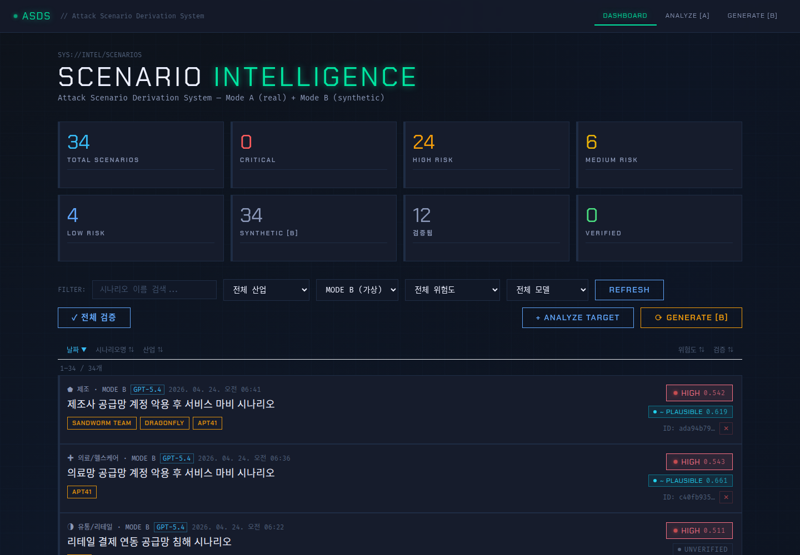
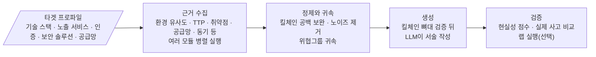
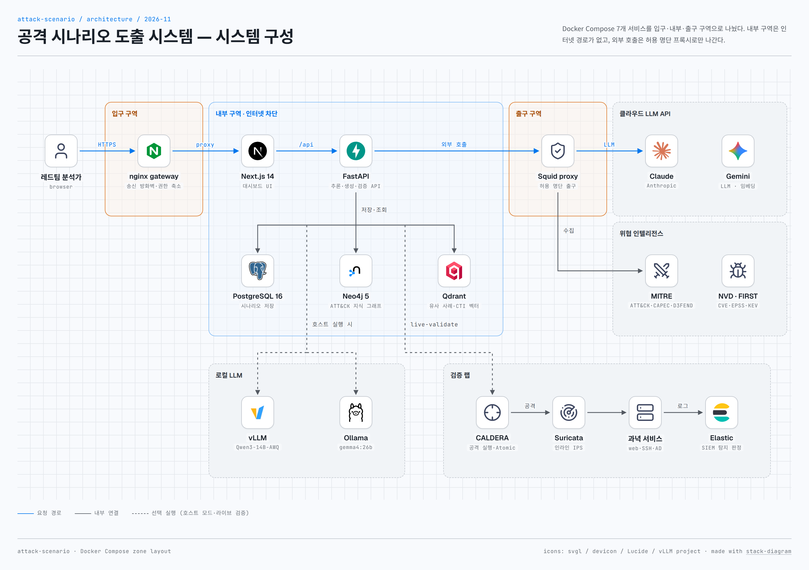
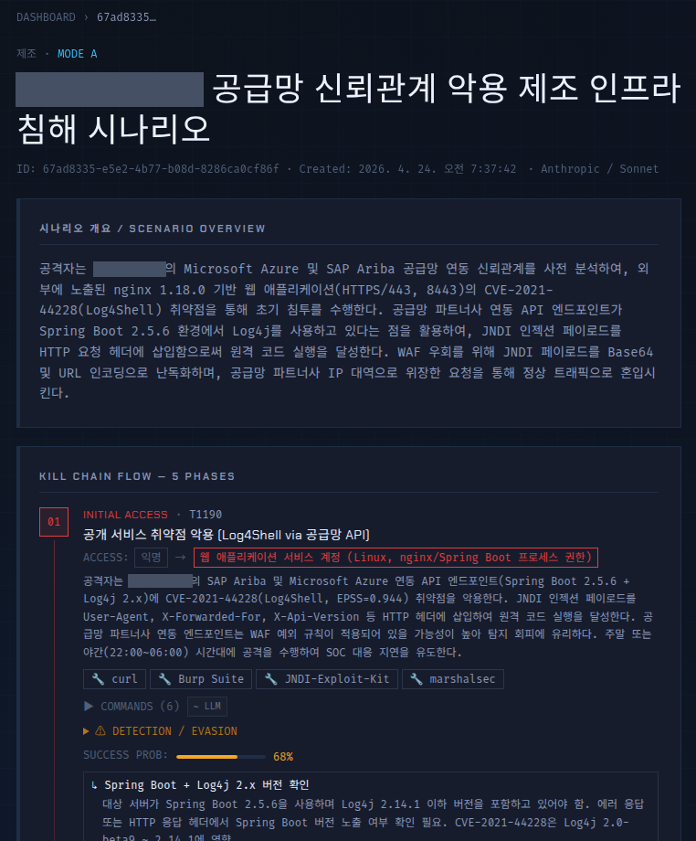
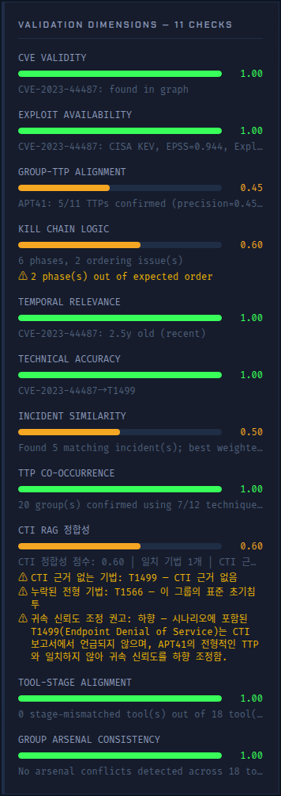
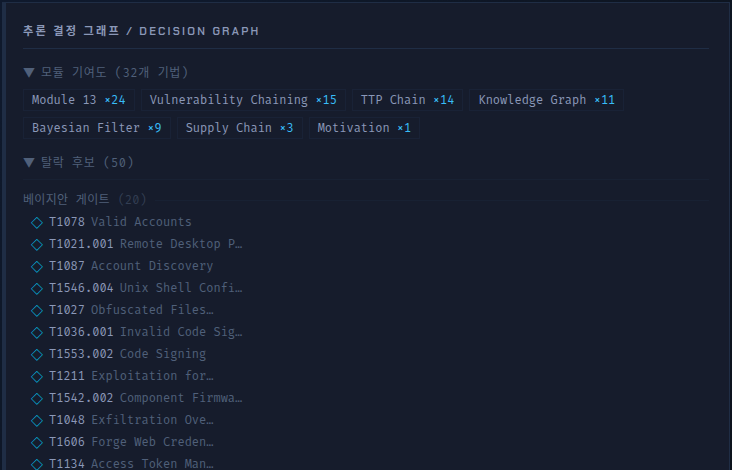
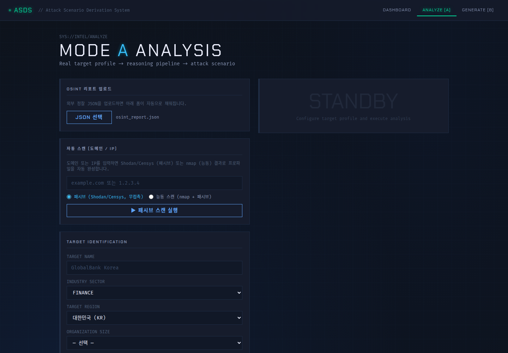

# ASDS — 공격 시나리오 도출 시스템

> 프로젝트 소개용 공개 사본입니다. 소스 코드는 비공개 저장소에서 관리합니다.

타겟 시스템 정보를 넣으면 **근거가 달린 레드팀 공격 시나리오**를 자동으로 만들고, 그 시나리오가 실제 사고와 얼마나 맞는지까지 검증하는 시스템입니다.

| 항목 | 내용 |
|---|---|
| 문제 | 특정 조직을 겨냥한 공격 시나리오를 만들려면 ATT&CK 기법·CVE·위협그룹·과거 사고를 사람이 일일이 엮어야 한다. 며칠이 걸리고, 왜 그 경로를 골랐는지 근거가 남지 않는다 |
| 접근 | 여러 추론 모듈이 지식 그래프와 취약점 데이터에서 근거를 모으고, LLM은 이미 고른 근거를 문장과 단계로 엮기만 한다. 결과는 실제 사고 사례와 격리 랩에서 다시 확인한다 |
| 결과물 | 단계별 킬체인, 위협그룹 귀속, 위험 점수, 현실성 검증 리포트, STIX 2.1·ATT&CK Navigator·PDF 등 8종 내보내기 |
| 규모 | 백엔드 약 40,000줄 · 프론트엔드 약 5,000줄 · 시험 1,022개 · 지식 그래프 노드 약 30만 / 관계 약 123만 · 실제 사고 기준 데이터 153건 |

## 주요 기능

- **두 가지 모드**: 실제 타겟 프로파일을 분석하는 Mode A(레드팀 운용), 가상 조직을 자동 생성하는 Mode B(학습 데이터).
- **타겟 입력**: 화면 입력, OSINT 리포트 업로드, 도메인·IP 스캔 결과로 프로파일을 채웁니다(인가 확인 뒤에만 동작).
- **근거 추적**: 시나리오마다 어떤 모듈이 어떤 기법을 냈고 어떤 후보가 왜 탈락했는지 결정 그래프로 보여 줍니다.
- **현실성 검증**: 여러 기준으로 점수를 매겨 `VERIFIED / PLAUSIBLE / QUESTIONABLE / UNREALISTIC` 등급을 붙이고, CTI 보고서와 어긋나는 부분을 경고합니다.
- **실제 사고 비교**: 국내외 실제 사고 153건과 위협그룹·기법·초기침투·킬체인 길이를 비교합니다.
- **격리 랩 실행 검증**(선택): 생성된 킬체인을 격리된 랩에서 실제로 실행하고, IDS·SIEM 기록으로 실행·탐지·차단 여부를 판정합니다.

## 동작 원리

LLM은 기법·CVE·위협그룹을 **고르지 않습니다**. 선택은 추론 모듈이 하고 LLM은 서술만 맡기 때문에, 같은 입력에는 같은 뼈대가 나오고 모든 기법을 출처 모듈까지 거슬러 올라갈 수 있습니다.

<picture>
  <source media="(prefers-color-scheme: dark)" srcset="images/architecture-dark.png">
  
</picture>

## 차별점

1. **LLM이 근거를 지어내지 않습니다.** CVE와 기법은 추론 모듈이 고른 것만 쓰고, 근거가 없으면 비워 둡니다. 존재하지 않는 CVE를 언급하는 문제를 이 구조로 없앴습니다.
2. **"그럴듯함"이 아니라 실제 사고로 평가합니다.** 실제 사고를 개발용과 평가용으로 나누고, 개선 전에 가설과 합격 기준을 먼저 적은 뒤 측정합니다. 기준에 못 미친 시도도 음성 결과로 기록합니다.
3. **공격 도구가 밖으로 함부로 나가지 못합니다.** 서비스를 입구·내부·출구 구역으로 나누고, 외부 호출은 허용 명단을 통과한 것만 내보냅니다.

## 문제 해결 사례

| 문제 | 해결 | 효과 |
|---|---|---|
| 특정 타겟 분석이 약 22분 걸림 | 모듈마다 반복하던 대량 조회를 한 번의 선조회와 캐시로 바꿈 | **22분 → 1.9초** |
| LLM이 존재하지 않는 CVE를 언급 | CVE 선택 권한을 LLM에서 추론 모듈로 옮김 | 허구 CVE 4/4건 → **0/4건** |
| 위협그룹 귀속 성능이 실제보다 좋게 측정됨 | 사고 이후에 쓰인 자료가 근거로 섞이는 시간 누출을 찾아 분리 | 낙관치 8/20을 공정 기준 **4/20으로 정정** |
| 킬체인이 지나치게 길어짐 | 업계 빈도·기법 동시 발생 통계로 후보를 걸러내는 단계를 실제 필터로 전환 | 탈락 이유가 결정 그래프에 남음 |
| 컨테이너 간 통신 경계가 없음 | 3구역 망 분리와 허용 명단 출구 | 격리 점검 **64/64 통과** |

## 품질 측정

평가용 실제 사고 20건(개발에 쓰지 않은 세트) 기준입니다.

| 지표 | 값 |
|---|---|
| 전술 적중률 | 0.49 |
| 전술 정밀도 | 0.39 (개선 전 0.33) |
| TTP 재현율 | 0.51 |
| 격리 랩 초기침투 실행 | 8/8 프로필 성공 |

## 화면

합성 타겟과 가상 조직으로 찍은 화면입니다. 조직명과 내부 튜닝 값은 가렸습니다.

**시나리오 상세** — 개요와 단계별 킬체인(권한 변화, 도구, 성공 확률, 사전조건 확인)

<table>
<tr>
<td width="34%" valign="top">

**현실성 검증** — 기준별 점수와 근거, CTI 대조 경고

</td>
<td width="66%" valign="top">

**추론 결정 그래프** — 모듈별 기여 기법 수와 탈락 후보

**Mode A 입력** — OSINT 업로드, 도메인·IP 스캔, 수동 입력

</td>
</tr>
</table>

## 기술 스택

| 영역 | 사용 기술 |
|---|---|
| 백엔드 | Python 3.11, FastAPI, Pydantic, SQLAlchemy |
| 데이터 | PostgreSQL, Neo4j, Qdrant |
| LLM | Claude, Gemini, OpenAI, vLLM(Qwen3), Ollama — 공급자 교체와 실패 시 대체 |
| 위협 데이터 | MITRE ATT&CK·CAPEC·D3FEND, NVD, FIRST EPSS, CISA KEV, Atomic Red Team, Sigma |
| 검증 랩 | MITRE CALDERA, Suricata, Elastic, ModSecurity, Samba AD |
| 프론트엔드 | Next.js 14, React, TypeScript, Tailwind CSS |
| 인프라·품질 | Docker Compose, nginx, Squid, Prometheus, OpenTelemetry, ruff, mypy(strict), pytest |

## 현재 상태와 한계

연구·시험 단계입니다.

- 위협그룹 귀속은 공정 기준 4/20으로 아직 낮습니다. 시점 통제를 지키면 쓸 수 있는 공개 CTI가 적습니다.
- 초기침투 추론이 웹 취약점 악용으로 쏠리는 경향이 있습니다.
- 검증 랩이 소규모라 엔드포인트 중심 기법은 판정하지 못합니다.

## 책임 있는 사용

허가받은 레드팀 훈련, 모의해킹, 방어 체계 검증을 위한 도구입니다. 스캔과 랩 실행은 인가 확인과 기본 비활성 설정 뒤에 있으며, 소유하거나 서면으로 허가받은 시스템에만 사용합니다.
